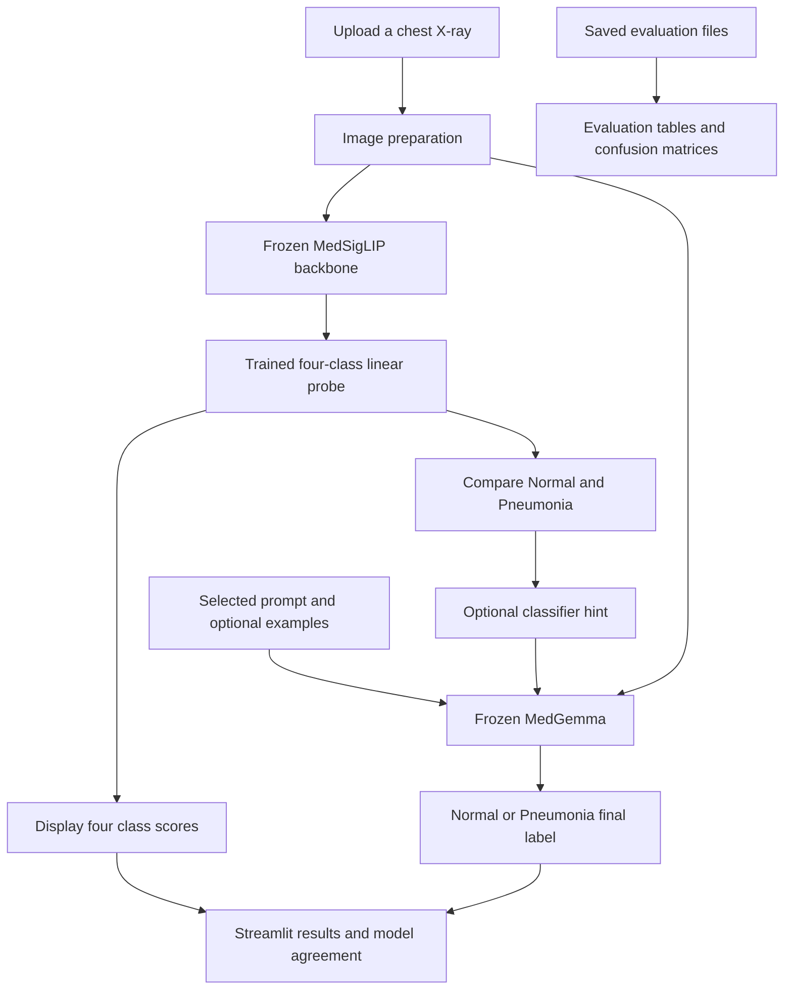

# Chest X-Ray AI: From Image Classification to a Hybrid Model Workflow

### A medical-imaging research project combining transfer learning, multimodal prompting, reproducible evaluation, and an interactive application.

**Python · PyTorch · Hugging Face Transformers · MedSigLIP · MedGemma · Streamlit · scikit-learn · pytest**

> **Research prototype. Not for clinical use.** This project investigates model behavior and evaluation methods; it is not a clinically validated diagnostic system.

## Project Overview

Can a specialist image classifier provide useful evidence to a multimodal language model—and can that second model correct the classifier when the image disagrees?

This project explores that question through two complementary components:

- **MedSigLIP + a trained linear probe** scores chest X-rays across COVID-19, Normal, Pneumonia, and Tuberculosis.
- **Frozen MedGemma** classifies Normal versus Pneumonia using the image, configurable instructions, and optional classifier hints or solved examples.

A Streamlit interface makes the evidence visible: users can inspect all four classifier scores, select a prompt, compare answers, and see when the models disagree. Separate evaluation scripts measure performance on controlled image splits.

**Recorded standalone MedGemma result:** 127/140 correct on a balanced Normal/Pneumonia test, with **90.71% accuracy**, **0.9071 macro F1**, and **0.8144 MCC**. These are standalone few-shot results, not evidence that the hybrid is better. [Read the saved evaluation report.](docs/medgemma_fresh_results.md)

## Why this problem is interesting

Image classification and language-model prompting solve different parts of the problem. A trained classifier provides a compact prediction, while a multimodal language model can evaluate the image under different instructions. Combining them introduces an engineering question: **will the language model correct the hint, or simply follow it?**

Accuracy alone cannot answer that question. The evaluator also counts how often MedGemma follows a hint, fixes an incorrect hint, or breaks a correct hint. This makes the hybrid's behavior measurable rather than assuming that two models must outperform one.

## Architecture



The classifier supports four labels; the current MedGemma comparison is binary. A COVID-19 or Tuberculosis top score remains visible in the interface, even when the hint compares only Normal and Pneumonia.

## What is trained—and what stays frozen?

| Component | Model or method | What this project changes |
|---|---|---|
| Image feature extractor | `google/medsiglip-448` | Backbone remains frozen |
| Image classifier head | Linear probe over MedSigLIP features | Trains the small classification layer |
| Multimodal final-answer model | `google/medgemma-1.5-4b-it` | Weights remain frozen; instructions and context vary |
| Earlier classifier experiments | DINOv2, RAD-DINO, DenseNet121, ResNet18 | Retained for comparison and project history |

A **linear probe** is a small classifier trained on features produced by a frozen model. It allows the project to adapt pretrained representations without updating the full image backbone.

**Few-shot prompting** means showing labeled examples inside the input conversation. It does not update MedGemma's weights.

## Technologies and their roles

| Technology | Role in this repository |
|---|---|
| Python | Model orchestration, data preparation, application logic, and evaluation |
| PyTorch | Model execution and classifier-head training |
| Hugging Face Transformers | Loading pretrained models, image processing, and chat-template generation |
| Streamlit | Upload interface, prompt selection, result cards, and evaluation dashboard |
| Pillow and NumPy | Image preparation and numerical operations |
| scikit-learn | Classification metrics and baseline methods |
| pandas | Tabular display of predictions and saved metrics |
| Matplotlib and Seaborn | Plots and confusion-matrix visualization |
| pytest and Streamlit AppTest | Automated model-helper and application-flow checks |
| Jupyter | Exploratory data analysis and earlier experiment notebooks |
| Git and GitHub | Version control, source review, and project documentation |

The configured inference device is **Apple MPS when available**, with a **CPU fallback**. The current configuration does not automatically select CUDA.

## Interactive application

The application has three tabs:

1. **Analyze X-ray:** upload a JPG/PNG, inspect four-class score bars, and compare MedSigLIP's binary hint with MedGemma's answer.
2. **Evaluation results:** inspect metrics, confusion matrices, and per-image predictions from existing output files.
3. **About:** understand the pipeline, prompt options, and limitations.

The prompt browser exposes the actual system text, question template, and token limit from the versioned prompt definitions.

| App label | Prompt key | Input supplied to MedGemma |
|---|---|---|
| Hint + score | `with_score` | Image, classifier label, and rescaled score |
| Hint only | `label_only` | Image and classifier label |
| Double-check | `double_check` | Image and scored hint, with instructions to review the image and override only on clear disagreement |
| No hint | `2c_v1` | Image only, without examples |
| No hint + 2 examples | `2c_fs1` | Image plus one solved Normal and one solved Pneumonia example; no classifier hint |

The interface rescales the binary scores as:

```text
Normal hint score = Normal raw score / (Normal raw score + Pneumonia raw score)
Pneumonia hint score = Pneumonia raw score / (Normal raw score + Pneumonia raw score)
```

This rescaling does **not** produce calibrated disease probabilities. Model agreement also does not prove that the answer is correct.

[Explore the full commented app source and setup guide.](docs/hybrid_streamlit_app.md)

## Evaluation designed around fair comparisons

### Why use development, validation, and test images?

| Split | Normal | Pneumonia | Purpose |
|---|---:|---:|---|
| Development | 20 | 20 | Inspect mistakes and develop prompts |
| Validation | 40 | 40 | Compare configurations and select a primary hybrid |
| Test | 70 | 70 | Evaluate after freezing the configuration |

These are project-specific sample sizes, not universal rules. The development split may be named `train` in older files, but it does not imply MedGemma weight training.

### Implemented evaluation safeguards

- Select hybrid evaluation images from the **original Testing folder**.
- Exclude SHA-256 duplicates recorded in earlier answer logs and manifests, including context examples and original counterparts of processed copies.
- Block exact duplicates of original Training/Validation images.
- Keep context examples separate from development, validation, and test targets.
- Compare all six evaluation conditions on the same target images.
- Freeze the selected configuration before allowing test inference.
- Record prompts, image hashes, model revisions, probe checksums, source hashes, and dependency versions.
- Save answers incrementally so an interrupted run can resume without mixing configurations.
- Preserve invalid answers as `Other` and count them as errors.

These controls reduce identifiable leakage; they do not establish patient independence or detect all near-duplicates and unrecorded historical use.

### What gets measured?

Accuracy, balanced accuracy, per-class precision, recall/sensitivity, specificity, F1, macro/weighted F1, MCC, invalid outputs, and confusion matrices.

For model interaction, the evaluator also measures:

- **Hint follow rate:** how often the final label matches the classifier hint.
- **MedSigLIP errors fixed:** incorrect hints corrected by the final answer.
- **Correct hints broken:** correct hints changed into wrong or invalid final answers.

### Distinguishing experiment configurations

The staged hybrid evaluator retains the earlier `hybrid_*_v1` prompts, raw classifier scores, and shared few-shot context. The interactive app exposes the newer named prompts and rescales binary scores; only its explicit few-shot choice supplies examples.

Those are **different configurations**. Their results must not be combined or attributed to one another. The app reads `outputs/hybrid_siglip_medgemma/`; the staged evaluator writes `outputs/hybrid_original_testing_20_40_70/`.

[Read the staged evaluation design and exact commands.](docs/hybrid_evaluation.md)

## Recorded results and current status

### Completed standalone MedGemma evaluation

| Split | Images | Accuracy | Macro F1 | MCC |
|---|---:|---:|---:|---:|
| Development | 40 | 90.00% | 0.8990 | 0.8165 |
| Validation | 80 | 88.75% | 0.8873 | 0.7772 |
| Test | 140 | 90.71% | 0.9071 | 0.8144 |

Test confusion matrix, with rows as actual labels and columns as predicted labels:

| Actual / Predicted | Normal | Pneumonia |
|---|---:|---:|
| Normal | 64 | 6 |
| Pneumonia | 7 | 63 |

The seven missed pneumonia cases illustrate why the accuracy figure should be accompanied by class-specific errors. The saved report contains the full precision, recall, specificity, and F1 results. This test has already been evaluated; it should not become a new prompt-tuning set while still being described as an untouched final test.

### Engineering status

- **Implemented:** trained-probe inference, frozen MedGemma inference, the Streamlit app, versioned prompts, and the staged hybrid evaluator.
- **Verified:** the repository's most recent automated run passed **105 tests that do not use real-model inference**; 11 real-model tests were deselected.
- **Not established:** a winning hybrid prompt or a demonstrated hybrid performance improvement.
- **Planned:** broader independent evaluation and a more complete agent that can route tools and handle disagreement.

## Engineering decisions worth discussing

| Decision | Reason |
|---|---|
| Frozen backbones with a small trained head | Adapt image representations without retraining the full backbone |
| Separate inference, UI, and evaluation modules | Make model behavior testable without running the entire interface |
| Preserve earlier prompt versions | Keep comparisons traceable rather than silently replacing experiment history |
| Cache model resources in Streamlit | Avoid reloading large weights on each interaction |
| Require an explicit freeze stage | Prevent accidental test inference during configuration selection |
| Validate exact output labels | Avoid turning ambiguous text into a confident-looking classification |
| Track hint fixes and breaks | Measure the actual contribution of the second model |
| Keep weights, datasets, and credentials outside Git | Keep the repository focused on reviewable source and documentation |

## Start reviewing the code here

| Area | Entry point |
|---|---|
| Streamlit application | [`frontend/app.py`](frontend/app.py) |
| Saved evaluation dashboard | [`frontend/evaluation.py`](frontend/evaluation.py) |
| Trained probe inference | [`backend/predict.py`](backend/predict.py) |
| MedGemma inference and answer parsing | [`backend/medgemma.py`](backend/medgemma.py) |
| Image preparation | [`backend/clean_image.py`](backend/clean_image.py) |
| Prompt definitions | [`prompt_engineering/prompts.py`](prompt_engineering/prompts.py) |
| Hybrid experiment orchestration | [`prompt_engineering/evaluate_hybrid.py`](prompt_engineering/evaluate_hybrid.py) |
| Probe training | [`training/train_probe.py`](training/train_probe.py) |
| Automated checks | [`tests/`](tests/) |
| Presentation materials | [`ppts/`](ppts/) |

## Run locally

From the repository root:

```bash
python3.12 -m venv .venv
source .venv/bin/activate
pip install -r requirements.txt
```

Accept the models' access terms on Hugging Face and authenticate with `hf auth login`. The model checkpoints and dataset are not included in Git. Follow the [README setup instructions](README.md#setup) to prepare the data and train the required probe.

The app's four-class probe is expected at:

```text
models/probe_medsiglip-448.pth
```

Then launch:

```bash
streamlit run frontend/app.py --server.port 8502
```

Open `http://localhost:8502`. The two-example option additionally requires the local data and split files used by the example-selection helper. The evaluation tab shows a friendly empty state when result files are unavailable.

Run automated checks without loading the real models:

```bash
python -m pytest -m "not slow"
```

For installation details, dataset layout, training commands, and historical experiments, see the [existing README](README.md).

## Limitations and next steps

The dataset contains source and age differences that can create shortcuts. Patient independence across splits and overlap with model pretraining data are unverified. Exact file hashing does not exclude every related image. Labels generated by MedGemma are not calibrated probabilities, and the current hybrid final answer is limited to Normal versus Pneumonia.

Next steps are to complete the frozen hybrid comparison, evaluate on broader independent datasets, investigate classifier mistakes and disagreement patterns, and develop the planned agent's tool-routing and review behavior. Any clinical application would require validation beyond the scope of this project.
