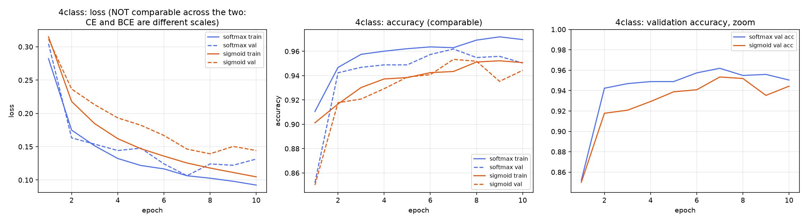
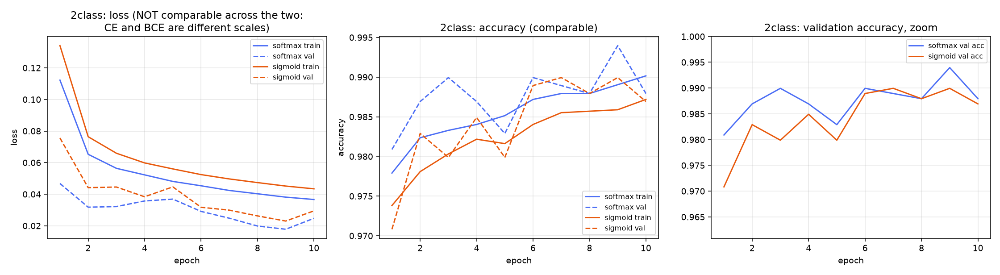
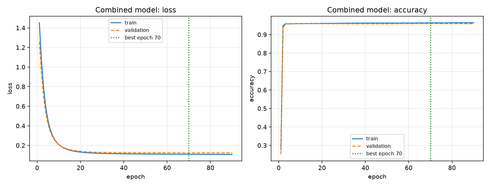
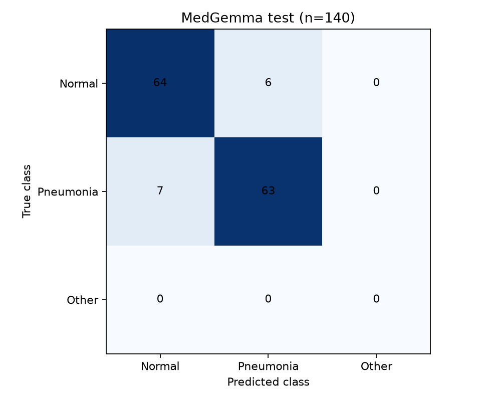

# Metrics results — senior review guide

Saved experiment artifacts published on November 10, 2026. Start here when reviewing the project. These are snapshots of existing runs; publishing them does not rerun training or evaluation. Metric values are preserved. Absolute workspace paths in text exports have been made relative.

## What to review first

| Priority | Evidence | What to check |
|---|---|---|
| 1 | [Classifier comparison CSV](evaluations/softmax_vs_sigmoid_metrics.csv) | Compare validation versus test accuracy, macro F1, AUC and loss separately for 2-class and 4-class tasks. Check sigmoid versus softmax. |
| 2 | [Fresh MedGemma summary CSV](medgemma_fresh_summary.csv), [full report](evaluations/medgemma_fresh_20_40_70/report.md) | Completed standalone few-shot evaluation: 127/140 test predictions correct (90.71%). Pneumonia sensitivity is 90%; specificity is 91.43%. Review 7 missed pneumonia cases and 6 false positives. |
| 3 | [Fresh test predictions](evaluations/medgemma_fresh_20_40_70/test_predictions.csv), [confusion matrix](evaluations/medgemma_fresh_20_40_70/test_confusion.png) | Inspect incorrect answers, raw responses and label parsing. Check sample counts and class balance. |
| 4 | [Prompt run logs](prompt_run_logs/), [earlier prompt CSV logs](evaluations/prompt_logs/) | Compare prompt wording, model response, classifier hints, timing and “Needs review” decisions. These small exploratory runs do not establish final test performance. Files ending in `previous_v1` are historical versions. |
| 5 | [NIH final evaluation JSON](evaluations/frozen_nih_threshold/step6_final_test.json), [NIH metric CSV](evaluations/nih_external_metrics.csv) | Review performance on external data. Frozen NIH methods achieve sensitivity 92–94% but specificity only 22%; the greedy baseline has 72% accuracy. Check thresholds, confidence intervals and false positives. These configurations differ from the classifier CSV and fresh standalone evaluation. |
| 6 | [Earlier combined comparison](evaluations/prompt_pipeline_combined_vs_medgemma.csv), [combined metrics](evaluations/combined_model_metrics.csv) | Check the `unseen only` subsets and overlap concerns before interpreting the very high combined-model results. This earlier combined classifier is separate from the newer dual-backbone experiment. |

## Curve images

Open the images directly or expand them on GitHub. Compare training and validation trends for divergence, late degradation and the selected epoch. Use the CSVs for exact held-out metrics; curves alone do not establish generalization.

### Four-class softmax versus sigmoid

[Four-class confusion matrices](evaluations/confusion_4class_softmax_vs_sigmoid.png)

### Normal versus Pneumonia softmax versus sigmoid

[Two-class confusion matrices](evaluations/confusion_2class_softmax_vs_sigmoid.png)

### Earlier combined classifier

[Combined confusion matrix](evaluations/confusion_combined_model.png)

### Fresh standalone MedGemma test

Label-only MedGemma answers do not support ROC-AUC, probability calibration or training-loss curves. [NIH development ROC figures](evaluations/frozen_nih_threshold/figures/) belong to a separate score-based protocol and development split.

## Run status and other evidence

- **Completed:** the fresh standalone MedGemma train/validation/test run; see its metric JSONs, prediction CSVs, report and [execution log](evaluations/medgemma_fresh_evaluation_run.log).
- **Historical/interrupted:** [initial MedGemma run](evaluations/medgemma_evaluation_run.log) and `medgemma_20_40_70/` are separate from the completed fresh run.
- **Prepared, no completed result in this snapshot:** [staged hybrid report](evaluations/hybrid_original_testing_20_40_70/report.md). Its protocol text does not establish hybrid accuracy. Preparation and guard-check logs are operational evidence only.
- **Incomplete:** [new distribution dual-backbone status](evaluations/new_distribution_fusion/status.json) records feature extraction, with zero test images processed. Its [training log](evaluations/new_distribution_fusion/training.log) and README do not establish completed metrics.
- **Other saved experiments:** `zero_shot_ensemble/`, `nih_zero_shot_ensemble/`, `nih_zero_shot_ensemble_20_each/`, `criteria_ensemble_v2/` and `criteria_ensemble_v2_softened/` retain their available CSVs and JSONs. Inspect their split, support and selection records; a folder name alone does not establish completion or comparability.

## Questions for the senior reviewer

1. Are splits independent at patient and source level? Exact image deduplication does not prove patient independence.
2. Are high internal scores driven by class-correlated source/age differences? Compare the NIH results before claiming generalization.
3. Is missing pneumonia or falsely flagging a normal image the greater concern for this research objective? Review sensitivity and specificity together.
4. Were prompts and thresholds selected using development/validation only, and was the test set previously used? The NIH final report explicitly notes earlier use of that set.
5. Do hints cause MedGemma to repeat classifier mistakes? Review wrong-hint corrections and broken correct hints only where that configuration has actual results.
6. Which configuration merits the next independent evaluation? Avoid ranking methods evaluated on different images as if they shared a test set.

## Artifact provenance

[artifact_index.csv](artifact_index.csv) lists each original local source, published path, byte count and SHA-256 hashes before and after path normalization. `medgemma_fresh_summary.csv` is derived from the three saved fresh metric JSONs. Dataset images, model weights, feature caches, dataset inventories and split manifests are not part of this review package. Original local artifacts remain in place.

This is research evidence, with patient independence and pretraining overlap unverified. Scores are not calibrated diagnostic certainty.
