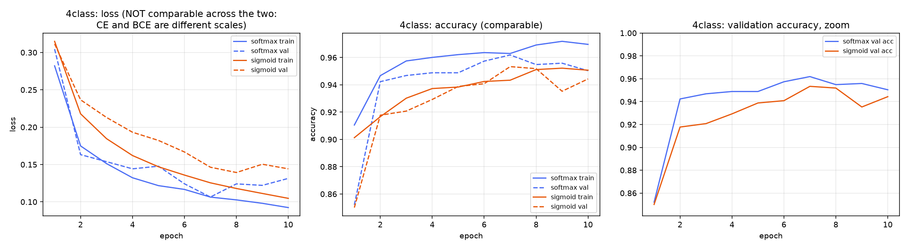
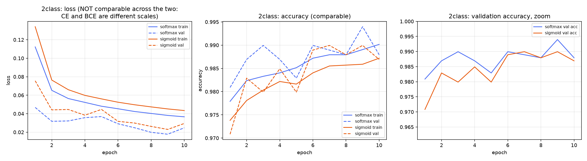
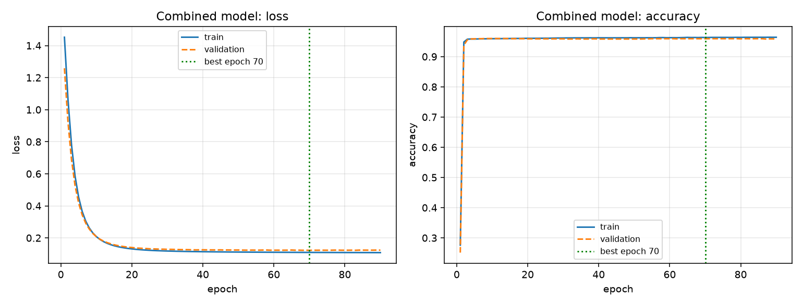
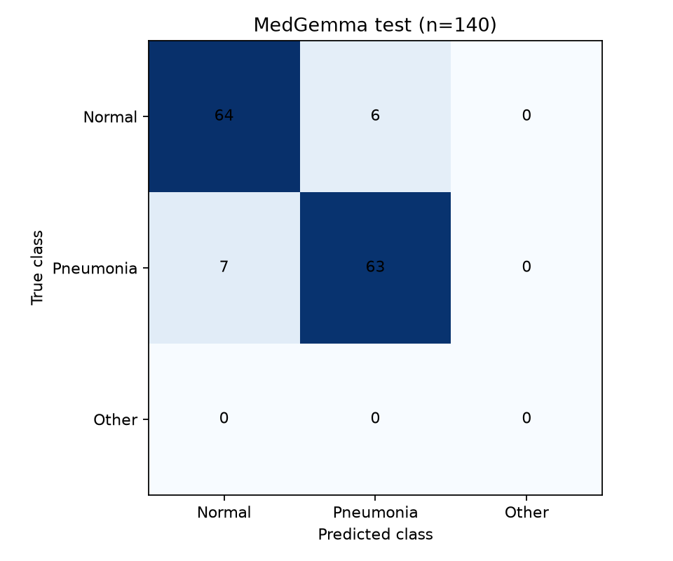

# Metrics results — senior review guide

Saved experiment artifacts published on November 10, 2026. Start here when reviewing the project. These are snapshots of existing runs; publishing them does not rerun training or evaluation. Metric values are preserved. Absolute workspace paths in text exports have been made relative.

## What to review first

| Priority | Evidence | What to check |
|---|---|---|
| 1 | [Classifier comparison CSV](evaluations/softmax_vs_sigmoid_metrics.csv) | Compare validation versus test accuracy, macro F1, AUC and loss separately for 2-class and 4-class tasks. Check sigmoid versus softmax. |
| 2 | [Fresh MedGemma summary CSV](medgemma_fresh_summary.csv), [full report](evaluations/medgemma_fresh_20_40_70/report.md) | Completed standalone few-shot evaluation: 127/140 test predictions correct (90.71%). Pneumonia sensitivity is 90%; specificity is 91.43%. Review 7 missed pneumonia cases and 6 false positives. |
| 3 | [Fresh test predictions](evaluations/medgemma_fresh_20_40_70/test_predictions.csv), [confusion matrix](evaluations/medgemma_fresh_20_40_70/test_confusion.png) | Inspect incorrect answers, raw responses and label parsing. Check sample counts and class balance. |
| 4 | [Prompt run logs](prompt_run_logs/), [earlier prompt CSV logs](evaluations/prompt_logs/) | Compare prompt wording, model response, classifier hints, timing and “Needs review” decisions. These small exploratory runs do not establish final test performance. Files ending in `previous_v1` are historical versions. |
| 5 | [NIH final evaluation JSON](evaluations/frozen_nih_threshold/step6_final_test.json), [NIH metric CSV](evaluations/nih_external_metrics.csv) | Review performance on external data. Frozen NIH methods achieve sensitivity 92–94% but specificity only 22%; the greedy baseline has 72% accuracy. Check thresholds, confidence intervals and false positives. These configurations differ from the classifier CSV and fresh standalone evaluation. |
| 6 | [Earlier combined comparison](evaluations/prompt_pipeline_combined_vs_medgemma.csv), [combined metrics](evaluations/combined_model_metrics.csv) | Check the `unseen only` subsets and overlap concerns before interpreting the very high combined-model results. This earlier combined classifier is separate from the newer dual-backbone experiment. |

## Curve images

Open the images directly or expand them on GitHub. Compare training and validation trends for divergence, late degradation and the selected epoch. Use the CSVs for exact held-out metrics; curves alone do not establish generalization.

### Four-class softmax versus sigmoid

[Four-class confusion matrices](evaluations/confusion_4class_softmax_vs_sigmoid.png)

### Normal versus Pneumonia softmax versus sigmoid

[Two-class confusion matrices](evaluations/confusion_2class_softmax_vs_sigmoid.png)

### Earlier combined classifier

[Combined confusion matrix](evaluations/confusion_combined_model.png)

### Fresh standalone MedGemma test

Label-only MedGemma answers do not support ROC-AUC, probability calibration or training-loss curves. [NIH development ROC figures](evaluations/frozen_nih_threshold/figures/) belong to a separate score-based protocol and development split.
